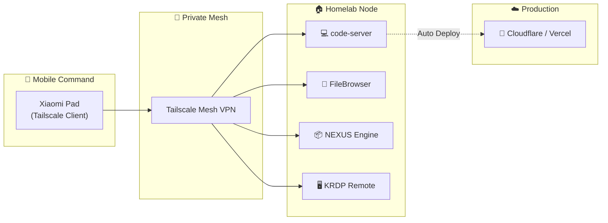

<!-- profile-readme -->
<h1 align="center">Farrel Apriandry</h1>

  

  

  <strong>Building tools for developers & Indonesian culture.</strong> 
  <a href="https://portfolio.relapri.my.id">portfolio.relapri.my.id</a> •
  <a href="https://linkedin.com/in/farrel-apriandry">LinkedIn</a> •
  <a href="https://x.com/fpriandry">X</a> •
  <a href="mailto:fapriandry@gmail.com">Email</a>

---

## 📊 GitHub Overview

  
  

  
  

<!-- 

  

 -->

<!-- 

  <picture>
    <source media="(prefers-color-scheme: dark)" srcset="https://raw.githubusercontent.com/FarrelApriandry/FarrelApriandry/output/github-snake-dark.svg">
    <source media="(prefers-color-scheme: light)" srcset="https://raw.githubusercontent.com/FarrelApriandry/FarrelApriandry/output/github-snake.svg">
    
  </picture>

 -->

---

## 🚀 Featured Projects

### 🎮 Flagship Spotlight: Nusantara: Pasar Bubrah
> 🥉 **Juara 3 UAD Fair 2025** · **P2MW 2025 Funded** · **5 Hak Kekayaan Intelektual (HAKI)**

  
   
  ▶️ <em>Klik thumbnail untuk memutar Official Trailer di YouTube</em> · <a href="https://github.com/FarrelApriandry/Nusantara-Pasar-Bubrah">Repositori Game</a>

| Project | Highlight | Stack | Link |
|---------|-----------|-------|------|
| **Nusantara: Pasar Bubrah** | 🥉 UAD Fair 2025 • 5 HAKI • P2MW 2025 | Unreal Engine, C++, Blender | [Repo](https://github.com/FarrelApriandry/Nusantara-Pasar-Bubrah) · [Trailer](https://www.youtube.com/watch?v=NIs8mJMRhfE) |
| **HAKI-Untidar** | Production @Untidar • IP management system | Astro, Express, Postgres, Prisma, Docker, Supabase | [Repo](https://github.com/FarrelApriandry/HAKI-Untidar) · [Live](https://haki.untidar.ac.id) |
| **Meragement** | Project mgmt SaaS • Role-based (admin/member/investor) | Astro, React, Neon PG, Drizzle, better-auth | [Repo](https://github.com/FarrelApriandry/Merantaw-Management) · [Demo](https://management.merantaw.my.id) |
| **Rel-Presentation** | HTML slide deck platform • Supabase auth/storage | Astro, React, TypeScript, Supabase, Bun | [Repo](https://github.com/FarrelApriandry/Rel-Presentation) · [Live](https://presentation.relapri.my.id) |
| **Jihyo-Archive** | Editorial luxury archive • "Classified file" UX | Astro, React, Supabase, Lucide | [Repo](https://github.com/FarrelApriandry/jihyo-archive) · [Live](https://jihyo-archive.vercel.app) |
| **VocaTIonal** | Zero-trust grievance system • Auto-migration, NPM whitelist | PHP, MySQL, Tailwind, Docker | [Repo](https://github.com/FarrelApriandry/Web-VocaTIonal) |
| **GolekDuit** | IDX swing trading engine • Fibonacci + volume breakout | Python, Node.js, Telegram Bot, yfinance | [Repo](https://github.com/FarrelApriandry/GolekDuit) |
| **Once-Tube** | High-perf YouTube TUI • TWICE aesthetic | Python, Textual, yt-dlp, mpv, uv | [Repo](https://github.com/FarrelApriandry/once-tube-TUI) |
| **RUPIAH Finance Tracker** | Multi-wallet • Real-time sync | Flutter, Firebase, Riverpod | [Repo](https://github.com/FarrelApriandry/RUPIAH-finance-tracker) |

---

## 💼 Experience

| Role | Org | Period | Focus |
|------|-----|--------|-------|
| **Game Dev & PM** | Merantaw.id | 2024–now | Nusantara: Pasar Bubrah, ZAPmarine, Unreal/Godot, CI/CD |
| **Full-Stack & DevSecOps** | HAKI Untidar (Faculty) | 2024–2025 | Astro SSR, Express API, Postgres, Docker, Supabase, GitHub Actions |
| **TA Algo Pemrograman** | Universitas Tidar | 2026–now | Teaching assistant, curriculum design |
| **Intern Game Dev** | Carakan Sadhana Dirgantara & Bodha Dharmaja Aryadhana | 2022–2024 | Game Programmer, 3D Designer, Blockchain Engineer |
| **Intern Mobile Dev** | Teknoreka | 2023–2024 | Mobile Developer & System Designer |

---

## ⚙️ Tech Stack

### 🕹️ Game Development & 3D Engineering

### 🌐 Frontend & UI

### ⚡ Backend & Databases

### 🚢 DevOps, Cloud & Systems

### 📱 Mobile Development

---

## 🛠️ Remote Dev & Homelab Architecture

> [!NOTE]
> Workflows are orchestrated remotely from a tablet setup via encrypted mesh networking.

---

## 🎓 Education

**S1 Teknologi Informasi** — Universitas Tidar (2024–now) · NPM: 2430506056  
**SMKN 2 Magelang — RPL** (2021–2024)

---

## 🏆 Selected Achievements

- **Juara 3** — UAD Fair 2025 (Nusantara: Pasar Bubrah)
- **P2MW 2025 Funded** — Nusantara: Pasar Bubrah
- **5 Hak Kekayaan Intelektual (HAKI)** registered for Nusantara
- **Top 8** — Krenova 2024 (Bolang the Explorer)
- **Deployed production systems** serving 10k+ users (HAKI-Untidar, Meragement)

---

## 📝 Latest Writing

<!-- BLOG-POST-LIST:START -->
- [Web Server Mastery: Implementing Nginx Server Blocks, Custom DNS, and SSL Hardening on Ubuntu…](https://fapriandry.medium.com/web-server-mastery-implementing-nginx-server-blocks-custom-dns-and-ssl-hardening-on-ubuntu-6103e60f9d5d?source=rss-8e75b39478b6------2)
- [Network Administration — Week 4: Provisioning ISC DHCP Server &amp; Deep-Diving DORA Protocol on Ubuntu…](https://fapriandry.medium.com/network-administration-week-4-provisioning-isc-dhcp-server-deep-diving-dora-protocol-on-ubuntu-4a152ede9b8d?source=rss-8e75b39478b6------2)
- [Network Administration — Day Three &lpar;Part 2&rpar;: Provisioning Windows Server 2019, PowerShell…](https://fapriandry.medium.com/network-administration-day-three-part-2-provisioning-windows-server-2019-powershell-c0ad455d8b29?source=rss-8e75b39478b6------2)
- [Network Administration — Day Three &lpar;Part 1&rpar;: Provisioning and Hardening Ubuntu Server 22.04](https://fapriandry.medium.com/network-administration-day-three-part-1-provisioning-and-hardening-ubuntu-server-22-04-3a6dcbfb9c3f?source=rss-8e75b39478b6------2)
- [ESP32 Firmware Basics: Environment Setup and Digital Output Control in Arduino IDE 2.0](https://fapriandry.medium.com/esp32-firmware-basics-environment-setup-and-digital-output-control-in-arduino-ide-2-0-22a9454b722c?source=rss-8e75b39478b6------2)
<!-- BLOG-POST-LIST:END -->

---

## 🤝 Let's Collaborate

Open to: **Full-Stack/DevOps contracts • Game dev collabs • Technical consulting • Mentoring**

  
  
  

💬 Fun facts & Engineering Mindset

- Runs homelab from Xiaomi Pad via Tailscale (code-server, FileBrowser, NEXUS, KRDP)
- Prefers **tablet-first UX** and **custom cyberpunk-utility UI** over stock frameworks
- S1 Skripsi candidates: (1) Monolith→Microservices + DevOps, (2) RAG IndoBERT for academic QA
- `git push origin main` > `git push origin master` since 2020

---

  Built with ☕ and late-night deploys. Last updated: October 2026

